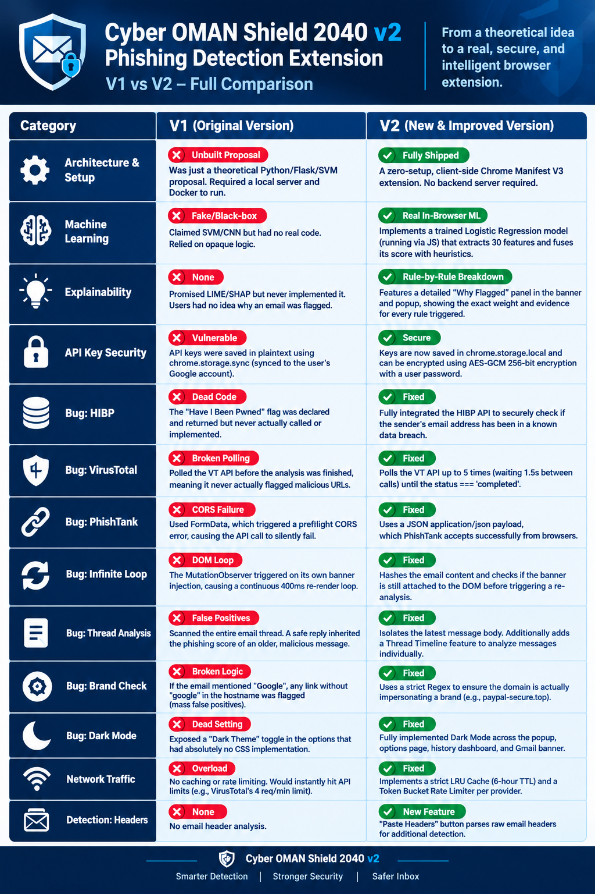
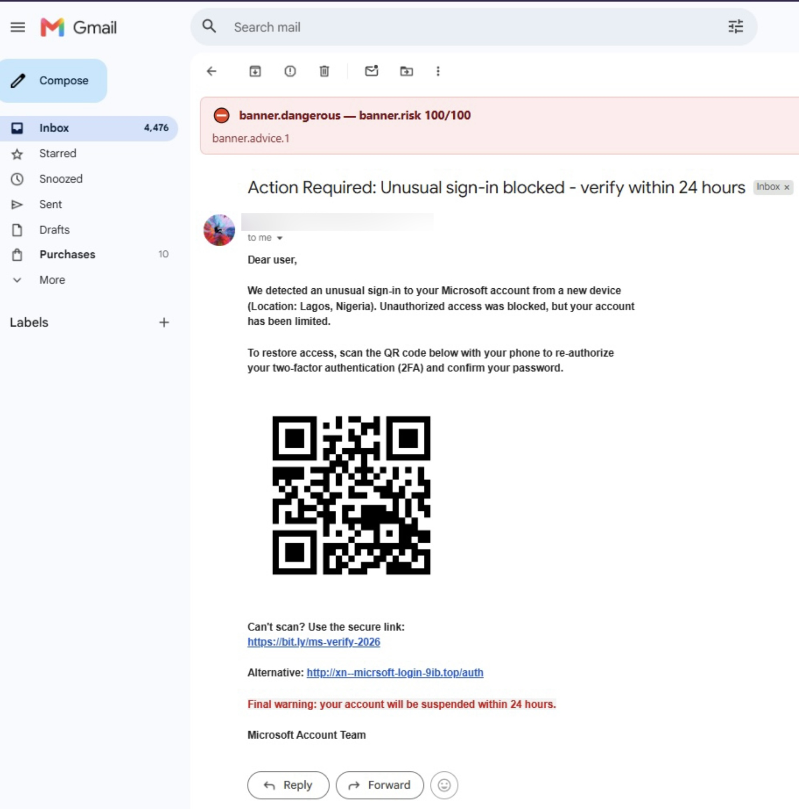
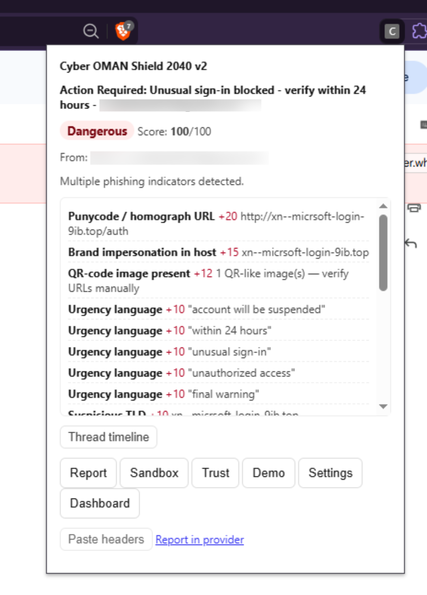

# 🛡️ Cyber OMAN Shield 2040 v2

**Real-time phishing detection for Gmail, Outlook, and Yahoo Mail.**
Local heuristics + on-device ML + optional threat intelligence. Runs fully client-side.


---

---

## 📖 Overview

**Cyber OMAN Shield 2040 v2** is a browser extension that analyzes opened emails in **Gmail**, **Outlook** (`outlook.live.com`, `outlook.office.com`) and **Yahoo Mail** and shows a clear **Safe / Suspicious / Dangerous** banner with a rule-by-rule explanation of *why* an email was flagged.

All analysis happens **locally in your browser**. External threat-intelligence lookups are **optional**, disabled by default, and send only URLs (and the sender email to HIBP, if enabled).

The project supports **English and Arabic** content and UI, with detection rules tuned for regional threats (e.g. Omani brands and banks).

---

## ✨ Features

### Detection
- **Heuristic engine** — weighted rules for keywords, urgency phrases, brand impersonation, suspicious TLDs, URL shorteners, IP-literal URLs and punycode domains.
- **On-device ML fusion** — logistic-regression score blended with heuristics.
- **Three risk tiers** — Safe / Suspicious / Dangerous with a 0–100 risk score.
- **Arabic + English** keywords and urgency phrases (extendable).
- **Attachment analysis** — risky extensions, double extensions (`invoice.pdf.exe`), macro-enabled Office files.
- **HTML forensics** — hidden text, `<script>`, `<iframe>`, forms, base64 images, tracking pixels.
- **QR-code image detection.**
- **Visual similarity check** for brand logos.
- **Sender reputation** and **first-seen sender** detection.
- **Thread analysis** — per-message timeline and thread history scoring.
- **Header parser** — paste raw headers to check SPF / DKIM / DMARC and Reply-To mismatch.
- **Display-name spoofing** and **Reply-To mismatch** detection.

### Threat Intelligence (optional)
- **VirusTotal**, **PhishTank**, **Google Safe Browsing**, **URLhaus (abuse.ch)**, **Have I Been Pwned (HIBP)**.
- Per-provider toggles, rate limiting, and result caching.

### User Experience
- Explainable banner with **"Why?"** breakdown (rule, weight, evidence).
- **Hover link preview** — shows real destination, highlights IP/punycode links.
- **Sound + desktop notification** on Dangerous emails.
- **Trusted-sender whitelist.**
- **Sandbox** — open a suspicious URL in an incognito window.
- **History dashboard** with stats, 14-day timeline, top senders and recent scans.
- **Demo mode** to showcase detection without a real phishing email.
- Light / Dark theme, font size and bold-text accessibility options.
- **English / Arabic** UI (RTL-aware).

### Reporting & Export
- Quick report links: **PhishTank**, **Google Safe Browsing**, **Google Support**, **Oman CERT**, **Microsoft**, **APWG**.
- **Self-audit JSON export** and **history CSV/JSON export**.

---

## ⚙️ How It Works

```
Mail DOM (Gmail / Outlook / Yahoo)
        │
        ▼
 content.js ── extract email (subject, sender, body, links, attachments)
        │
        ├─► HTML forensics · QR · visual similarity · sender reputation · thread analysis
        ├─► lib/scoring.js  (heuristics + ML fusion + rules.json weights)
        │
        ├─(optional)─► background.js ─► VirusTotal / PhishTank / Safe Browsing / URLhaus / HIBP
        │                     └─ cache (LRU, TTL) + per-minute rate limiter
        ▼
 Merge scores → apply whitelist → render banner → save history
        │
        ▼
 popup.js reads last result via COS_GET_LAST_RESULT
```

| Component | Role |
|---|---|
| `content.js` | Runs on mail sites. Extracts the message, runs local analysis, injects the banner, de-duplicates per message hash. |
| `background.js` | MV3 service worker. Handles provider calls, caching, rate limiting, rule updates, sandbox window. |
| `popup.js` | Shows the last analysis, thread timeline, header analysis and quick actions. |
| `options.js` | Preferences, API keys (with optional encryption), rules override, history, whitelist, exports. |
| `dashboard.js` | History statistics, timeline chart, top senders, recent scans. |
| `lib/*` | Shared modules attached to `globalThis.COSShield`. |

### Internal message types

| Message | Purpose |
|---|---|
| `COS_API_CHECKS` | Run external provider checks |
| `COS_ADD_HISTORY` | Save a scan entry |
| `COS_GET_STATE` | Fetch prefs, keys, whitelist, history |
| `COS_TEST_PROVIDERS` | Test enabled providers |
| `COS_CLEAR_CACHE` | Clear provider cache |
| `COS_CHECK_RULES_UPDATE` / `COS_GET_EFFECTIVE_RULES` | Rule update / retrieval |
| `COS_OPEN_SANDBOX` | Open URL in incognito window |
| `COS_GET_LAST_RESULT` | Popup → content: last analysis |
| `COS_TRUST_SENDER` / `COS_UNTRUST_SENDER` | Manage whitelist |
| `COS_RUN_DEMO` | Render demo phishing analysis |
| `COS_ANALYZE_HEADERS` | Analyze pasted raw headers |
| `COS_REFRESH_PREFS` | Reload preferences in open tabs |

---

## 📦 Installation

### Requirements
- Chrome / Edge / Chromium **102+** (Manifest V3) or Firefox **115+**
- Node.js 18+ (only for linting, formatting and tests)

### Chrome / Edge / Brave
1. Clone or download this repository.
2. Open `chrome://extensions` (or `edge://extensions`).
3. Enable **Developer mode**.
4. Click **Load unpacked** and select the project folder.
5. Pin the extension and open Gmail / Outlook / Yahoo Mail.

### Firefox
```bash
npm run build:firefox      # copies manifest.firefox.json -> manifest.json
```
> ⚠️ This **overwrites** `manifest.json`. Keep a backup of the Chrome manifest first (e.g. `cp manifest.json manifest.chrome.json`).

Then open `about:debugging#/runtime/this-firefox` → **Load Temporary Add-on** → select `manifest.json`.

### Enable Sandbox (optional)
The **Sandbox** button opens URLs in an incognito window. In `chrome://extensions` → extension **Details** → enable **Allow in Incognito**.

---

## 🚀 Usage

1. Open an email in Gmail, Outlook or Yahoo Mail.
2. A banner appears at the top of the message:
   - ✅ **Safe** · ⚠️ **Suspicious** · ⛔ **Dangerous** · 🔵 **Trusted**
3. Click **Why?** to see each finding with its weight and evidence.
4. Click the extension icon for the popup:

| Button | Action |
|---|---|
| **Report** | Open the provider's phishing report page |
| **Sandbox** | Open a URL in an incognito window |
| **Trust** | Add the sender to the trusted whitelist |
| **Demo** | Render a sample phishing analysis |
| **Settings** | Open the options page |
| **Dashboard** | Open the history dashboard |
| **Paste headers** | Analyze raw headers (SPF / DKIM / DMARC, Reply-To) |

### Analyzing email headers
1. In Gmail: **⋮ → Show original → Copy to clipboard**.
2. Open the popup → **Paste headers** → paste into the box.
3. Results show SPF, DKIM, DMARC status and any findings.

### Quick demo
See [`DEMO_SCRIPT.md`](DEMO_SCRIPT.md) for a 70-second walkthrough and a sample phishing email.

---

## 🔧 Settings

Open **Options** from the popup (or the extension's details page).

| Tab | What you can do |
|---|---|
| **Appearance** | Language (EN/AR), font size, bold banner text, theme, debug logging |
| **Detection** | Toggle external checks, each provider, ML, QR, hover preview, visual similarity, sound/notifications |
| **Rules** | Add extra keywords, brands and suspicious TLDs locally |
| **API Keys** | Enter provider keys, test providers, encrypt keys with a password |
| **Advanced** | Cache TTL, rate limit, auto-update rules, clear history/cache/whitelist, exports |
| **About** | Version, rules version, ML model version, history/whitelist counts |

### Default values
| Setting | Default |
|---|---|
| External checks | Off |
| Cache TTL | 6 hours (max 1000 entries) |
| Rate limit | 4 requests / minute |
| URLs checked per email | up to 10 (VirusTotal / PhishTank: first 3) |
| Auto-update rules | Off |

---

## 🌐 Threat Intelligence Providers

All providers are **optional**. Enable *External threat intelligence* first, then pick providers.

| Provider | Key needed | Data sent |
|---|---|---|
| VirusTotal | API key | URL |
| PhishTank | App key | URL |
| Google Safe Browsing | API key | URLs |
| URLhaus (abuse.ch) | None | URLs |
| Have I Been Pwned | Paid API key | Sender email |

Providers that flag a URL add the `externalFlag` weight to the risk score (capped at +50 in total).

---

## 📏 Rules Configuration

All weights and lists live in [`rules.json`](rules.json). The `version` field is shown in the banner and audit export.

```jsonc
{
  "version": "3.0.0",
  "tiers": { "safe": 30, "suspicious": 70 },   // score thresholds
  "weights": { "keyword": 5, "ipUrl": 25, "punycode": 20, "doubleExtension": 30, ... },
  "keywords": [...],  "urgencyPhrases": [...],
  "arabic": { "keywords": [...], "urgencyPhrases": [...] },
  "brands": [...],    "suspiciousTlds": [...],  "shorteners": [...],
  "riskyExtensions": [...],  "macroExtensions": [...],
  "doubleExtensionPattern": "...",
  "reportUrls": { ... },  "brandVisualHashes": { ... },  "ruleChangelog": [...]
}
```

### Key weights
| Rule | Weight | Rule | Weight |
|---|---|---|---|
| keyword | 5 | riskyAttachment | 25 |
| urgencyPhrase | 10 | doubleExtension | 30 |
| brandImpersonation | 15 | macroAttachment | 20 |
| ipUrl | 25 | externalFlag | 25 |
| suspiciousTld | 10 | hiddenText / formTag | 15 |
| punycode | 20 | qrImage | 12 |
| shortener | 8 | visualMatch | 18 |
| displayNameSpoof / replyToMismatch | 20 | headerAuthFail | 25 |

### Local overrides
**Options → Rules** lets you append keywords, brands and TLDs on top of the shipped `rules.json`. Overrides are stored locally and the rules version becomes `<version>+local`. Use **Reset to default** to remove them.

### Auto-update
When enabled, rules are checked daily (alarm) and on install from `raw.githubusercontent.com`.

---

## 🗂️ Project Structure

```
.
├── manifest.json            # Chrome / Edge (MV3)
├── manifest.firefox.json    # Firefox build manifest
├── background.js            # Service worker
├── content.js               # Mail-site content script
├── popup.html / popup.js    # Toolbar popup
├── options.html / options.js# Settings page
├── dashboard/
│   ├── dashboard.html
│   ├── dashboard.css
│   └── dashboard.js
├── styles.css               # Banner, popup, options styles
├── rules.json               # Detection rules & weights
├── lib/
│   ├── logger.js  storage.js  cache.js  rate-limiter.js  crypto.js  i18n.js
│   ├── url-analysis.js  attachments.js  qr.js  html-forensics.js
│   ├── header-parser.js  sender-reputation.js  thread-analysis.js
│   ├── visual-similarity.js  notifications.js  ml.js  rule-updates.js
│   ├── scoring.js
│   ├── site-gmail.js  site-outlook.js  site-yahoo.js
│   └── locale/ (en.json, ar.json)
├── ml/model.json            # Logistic-regression model
├── icons/                   # 16 / 48 / 128 px
├── docs/                    # ARCHITECTURE, PRIVACY_POLICY, USAGE, ...
├── tests/                   # node --test
├── DEMO_SCRIPT.md
├── .eslintrc.json
├── .prettierrc
└── package.json
```

### Permissions

| Permission | Why |
|---|---|
| `storage` | Preferences, keys, history, whitelist |
| `activeTab`, `tabs` | Popup ↔ content-script messaging, refresh prefs |
| `scripting` | Extension scripting support |
| `notifications` | Desktop alert on Dangerous emails |
| `downloads` | CSV / JSON / audit exports |
| Host: mail sites | Run the content script |
| Host: provider APIs, `raw.githubusercontent.com` | Optional threat-intel and rule updates |

---

## 🧑‍💻 Development

```bash
npm install          # install eslint + prettier
npm run lint         # eslint . --ext .js
npm run format       # prettier --write
npm test             # node --test tests/
npm run build:firefox
```

- Code style: ESLint (`semi`, `eqeqeq`, `no-undef`, `no-redeclare`) and Prettier.
- Shared modules attach to `globalThis.COSShield` (`window.COSShield` in pages).
- Site selectors live in `lib/site-*.js` — update them if the mail UI changes.
- Enable **Debug logging** in Options → Appearance for verbose console output.

### Adding a new mail provider
1. Create `lib/site-<name>.js` exposing `id`, `extract()`, `collectMessages()`.
2. Register it in `detectSite()` in `content.js`.
3. Add the host to `matches` and `host_permissions` in both manifests.

---

## 🔐 Privacy & Security

- Email content is analyzed **locally**; nothing leaves your device unless external checks are enabled.
- **URLs only** go to the providers you enable; the **sender email only** goes to HIBP (if enabled).
- API keys live in `chrome.storage.local` and are **never synced**. Optional **AES-GCM password encryption** is available.
- History and whitelist are stored locally; clear them any time in **Options → Advanced**.
- No server, no telemetry, no analytics.
- Banner and dashboard output is HTML-escaped to avoid injection from email content.

Full details: [`docs/PRIVACY_POLICY.md`](docs/PRIVACY_POLICY.md).

---

## ⚠️ Limitations

- Gmail / Outlook / Yahoo DOM may change; selectors are in `lib/site-*.js`.
- SPF / DKIM / DMARC require a manual header paste (no Gmail API integration).
- HIBP requires a paid API key.
- Client-side API keys are never truly secret; encryption is defense-in-depth.
- Heuristic and ML detection can produce false positives/negatives — treat results as guidance, not a guarantee.
- Brand visual hashes in `rules.json` are sample values and should be replaced with real logo hashes for production use.

---

## 📚 Documentation

- [`docs/ARCHITECTURE.md`](docs/ARCHITECTURE.md)
- [`docs/PRIVACY_POLICY.md`](docs/PRIVACY_POLICY.md)
- [`docs/USAGE.md`](docs/USAGE.md)
- [`docs/SCREENSHOTS.md`](docs/SCREENSHOTS.md)
- [`docs/I18N.md`](docs/I18N.md)
- [`docs/FIREFOX.md`](docs/FIREFOX.md)
- [`docs/SITES.md`](docs/SITES.md)
- [`DEMO_SCRIPT.md`](DEMO_SCRIPT.md)

---

## 🤝 Contributing

1. Fork the repo and create a feature branch.
2. Run `npm run lint` and `npm run format` before committing.
3. Add or update tests in `tests/`.
4. Open a pull request describing the change.

Rule and keyword contributions (especially Arabic and regional brands) are welcome.

---

## 📜 Disclaimer

This tool is built for **education, research and defensive security**. It assists users in spotting phishing but does not guarantee protection. Always verify suspicious emails through official channels. Only test it against emails and systems you are authorized to use.

---

## Screenshot





Originally developed as a graduation project (CyberOMANShield 2040), v2 extends it into a cross-browser extension.

v2 Developed by : M.alfahdi 

---

## 📄 License

Released under the **MIT License**.
